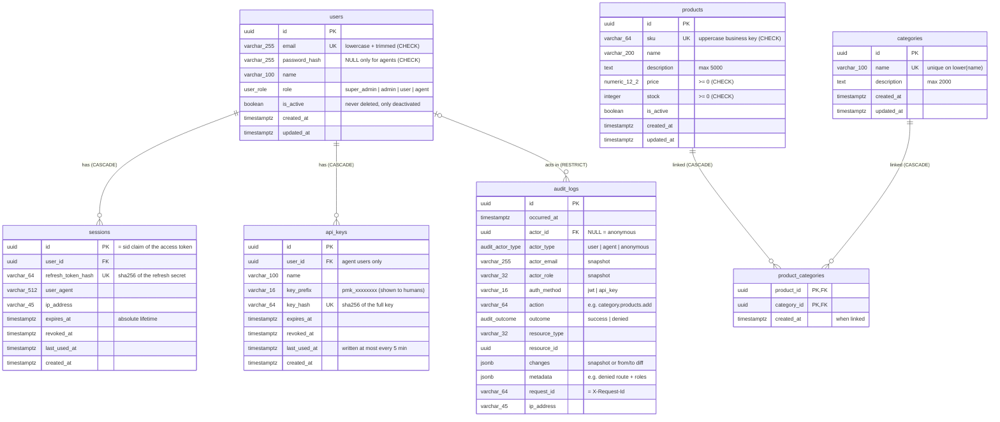

# Database design

PostgreSQL 16. The schema is created **only** by migrations
(`src/database/migrations`, `synchronize` is always off). Column names are
snake_case, every timestamp is `timestamptz`, and every key and constraint has
an explicit, readable name.

## ERD

## Tables

### users
| Constraint / index | Purpose |
| --- | --- |
| `PK_users` | uuid primary key (`gen_random_uuid()`) |
| `UQ_users_email` | one account per email |
| `CHK_users_email_normalized` | `email = lower(btrim(email))`, so uniqueness is effectively case-insensitive |
| `CHK_users_password_by_role` | `(role = 'agent') = (password_hash IS NULL)`: agents can never log in with a password, humans always have one |
| `UQ_users_single_super_admin` | partial unique index on `role WHERE role = 'super_admin'`: at most one super_admin |

Users are never deleted (business rule). Access is removed with `is_active = false`.

### sessions
One row per login. Its `id` is the `sid` claim of every access token issued for
it, so revoking the row invalidates those tokens immediately.
`UQ_sessions_refresh_token_hash` and `IDX_sessions_user_id` (logout-all,
deactivation). `FK_sessions_user_id ... ON DELETE CASCADE`.

### api_keys
Agent keys. Only `key_prefix` (to recognize a key) and `key_hash` (sha256, used
for lookup, `UQ_api_keys_key_hash`) are stored; the key itself is never stored.
`IDX_api_keys_user_id`, `FK_api_keys_user_id ... ON DELETE CASCADE`.

### products
| Constraint | Rule |
| --- | --- |
| `UQ_products_sku` | unique SKU |
| `CHK_products_sku_format` | `^[A-Z0-9][A-Z0-9-]{0,63}$` (the API uppercases input) |
| `CHK_products_name_not_blank` | name is not only spaces |
| `CHK_products_price_non_negative`, `CHK_products_stock_non_negative` | no negative money or stock |
| `CHK_products_description_length` | at most 5000 characters |

### categories
`UQ_categories_name_lower`: a unique **expression** index on `lower(name)`
("Keyboards" and "keyboards" conflict). It is written by hand in the migration
because TypeORM cannot express it. Also `CHK_categories_name_not_blank` and
`CHK_categories_description_length` (2000).

### product_categories (the many-to-many)
- `PK_product_categories (product_id, category_id)`: a pair can exist only once.
  As the leading column, `product_id` also serves "categories of a product".
- `IDX_product_categories_category_id`: "products of a category".
- Both FKs `ON DELETE CASCADE`: deleting a product or a category removes its
  links, never the other side.
- `created_at`: when the product was put into the category.

### audit_logs
Append-only: the trigger `TRG_audit_logs_append_only` makes every `UPDATE` and
`DELETE` fail (`audit_logs is append-only`). Indexes: `IDX_audit_logs_occurred_at`
(newest-first listing), `IDX_audit_logs_resource (resource_type, resource_id)`
("history of this product"), `IDX_audit_logs_actor_id` ("what did this agent do").
Through the API only super_admin can read it (`GET /api/audit-logs`, separation
of duties); nobody can write to it.
`FK_audit_logs_actor_id ... ON DELETE RESTRICT`: since users are never deleted,
an audit row always points to its actor. Email and role are also stored as
snapshots, so the row stays correct even if the user changes later.

## Design decisions

1. **UUID keys everywhere** (`gen_random_uuid()`, built into PostgreSQL 13+, no
   extension). Ids are not guessable or countable through the API, and a session
   id can be generated by the app before the insert (it is part of the refresh token).
2. **An explicit join entity** (`product_categories`) instead of an implicit
   `@ManyToMany`: readable constraint names, a `created_at`, and full control over
   cascades.
3. **Integrity in the database, not only in code.** Every rule that must never be
   broken (unique email/SKU/category name, non-negative price and stock, one
   super_admin, agents without passwords, append-only audit) is a constraint, so
   it also holds for concurrent requests and manual SQL. The API maps violations
   to clean errors: unique/FK → 409, check → 400.
4. **Money as `numeric(12,2)`**, passed through the API as a decimal string: no
   floating-point rounding.
5. **Additional attributes** beyond name and description: `sku` (a stable
   business key for humans and agents), `price`, `stock`, `is_active` (hide a
   product without deleting it) on products; `created_at`/`updated_at` everywhere.
6. **Hard delete for catalog data, with an audit snapshot.** Deleting a product
   or category removes it and its links (CASCADE). The full "before" state is
   kept in `audit_logs.changes`. Users, in contrast, are never deleted.
7. **Audit rows are written in the same transaction** as the change they
   describe: either both are committed or neither is (tested: a failed write
   leaves no audit row).
8. **Row locks (`SELECT … FOR UPDATE`)** on the product/category/user/session
   being changed, so concurrent changes run one after the other and the "before"
   values in the audit log are always correct.
