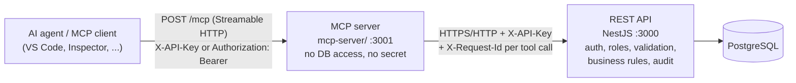

# MCP server and tools

The MCP server lets AI agents use the Product Management system through
[Model Context Protocol](https://modelcontextprotocol.io) tools. It lives in
[`mcp-server/`](../mcp-server) and runs as the `mcp` service in Docker Compose
on http://localhost:3001/mcp.

## Architecture



The MCP server is a **pure client of the REST API**. It never connects to the
database and imports no code from the API (`src/`). Every tool is one HTTP
call, so authentication, role checks, validation, business rules and audit
logging are all enforced by the API, and the MCP server cannot bypass them.

## Protocol

- **SDK:** TypeScript SDK v2 (`@modelcontextprotocol/server` 2.3, `@modelcontextprotocol/node` 2.1).
- **Transport:** Streamable HTTP at `POST /mcp`, **stateless** (no server-side sessions).
- **Revisions:** `createMcpHandler` serves **2026-07-28** and, through its
  default `legacy: 'stateless'` fallback, the **2025** revision (`initialize`
  handshake), on the same URL. Both are tested end to end. Session operations
  of the 2025 era (`GET`/`DELETE /mcp`) answer `405`, since there are no sessions.
- `GET /health` (public): `200 {"status":"ok","api":"up"}` only when the API's own
  health endpoint answers; otherwise `503`.

## Authentication: key passthrough

| Step | What happens |
| --- | --- |
| 1 | The MCP client sends the agent's API key on **every** HTTP request: `X-API-Key: <key>` or `Authorization: Bearer <key>` (both accepted; `X-API-Key` wins if both are sent) |
| 2 | No key → **HTTP 401** before any MCP handling |
| 3 | The key is handed to a fresh per-request MCP server instance, whose API client forwards it as `X-API-Key` |
| 4 | The **API** decides who the caller is and what it may do. An invalid, revoked or expired key, or an inactive agent → tool error `UNAUTHORIZED` |

The MCP server stores **no secret**, and it never logs the key (not even part of
it). Log lines contain only tool name, request id, outcome, error code and
duration, and a redaction filter masks anything key-like as a second safeguard.

Example log line:
```
2026-10-20T08:02:00.103Z [mcp] tool=create_category requestId=a45c90df-3a7c-44ff-b984-fa8b74c347ad outcome=error code=CONFLICT durationMs=15
```

## Permissions

The agent role (enforced by the API) may:
- **read** products and categories, including their relationships;
- **create, update and delete categories** and **manage which products are in them**.

It may **not** create, update or delete products, so **no product write tools
are exposed**. Offering tools the agent can never use contradicts least
privilege: it misleads the model, wastes its context and invites failed calls.
If the agent role is ever given product rights in the API, tools can be added.

## Results and errors

Every tool result has:
- `content[0]`: a short text summary;
- `content[1]`: the same data as JSON text (for clients without `structuredContent`);
- `structuredContent`: the JSON object, always including the `requestId` of the API call.

A failed call returns `isError: true` with `structuredContent.error`:

```json
{
  "content": [
    { "type": "text", "text": "CONFLICT: A resource with the same unique value already exists" },
    { "type": "text", "text": "{\"error\":{\"code\":\"CONFLICT\",...}}" }
  ],
  "structuredContent": {
    "error": {
      "code": "CONFLICT",
      "message": "A resource with the same unique value already exists",
      "requestId": "40bf6d72-84c1-44e1-be89-05491c06f97a"
    }
  },
  "isError": true
}
```

| Code | When |
| --- | --- |
| `VALIDATION_ERROR` | The API rejected the input (`details: [{ field, message }]`), e.g. unknown product ids |
| `UNAUTHORIZED` | The key is invalid, revoked or expired, or the agent is deactivated |
| `FORBIDDEN` | The role is not allowed (does not happen with the 10 tools for an agent) |
| `NOT_FOUND` | Unknown category/product, or the product is not in the category |
| `CONFLICT` | Category name already taken (case-insensitive), or a related-resource conflict |
| `TOO_MANY_REQUESTS` | API rate limit |
| `INTERNAL_ERROR` / `SERVICE_UNAVAILABLE` / `BAD_REQUEST` | Passed through from the API |
| `UPSTREAM_UNAVAILABLE` | The MCP server could not reach the API, or it timed out (`API_TIMEOUT_MS`) |

Input that does not match a tool's schema (e.g. an id that is not a UUID) is
rejected by the MCP layer before any API call, also as `isError: true`.

The `requestId` is the `X-Request-Id` the MCP server generated for that API
call. It appears in the API logs and in the audit row of the change.

## Tools

UUIDs accept any version. Strings are trimmed. Limits match the API DTOs.

### Read tools (`readOnlyHint: true`, `idempotentHint: true`)

#### `list_products`
List products with their categories, paginated (newest first by default).
**Permission:** any authenticated role.

| Field | Type | Required | Constraints |
| --- | --- | --- | --- |
| `page` | integer | no | ≥ 1, default 1 |
| `limit` | integer | no | 1-100, default 20 |
| `search` | string | no | ≤ 100; case-insensitive match on name or SKU |
| `categoryId` | UUID | no | only products in this category |
| `isActive` | boolean | no | |
| `sortBy` | enum | no | `name`, `sku`, `price`, `createdAt` (default) |
| `sortOrder` | enum | no | `asc`, `desc` (default) |

Example call: `{ "search": "keyboard", "sortBy": "price", "sortOrder": "asc" }`
Example result (`structuredContent`):
```json
{
  "items": [
    {
      "id": "6a1c…", "sku": "KB-001", "name": "Mechanical keyboard", "description": "RGB",
      "price": "129.90", "stock": 25, "isActive": true,
      "categories": [{ "id": "74d9…", "name": "Keyboards" }],
      "createdAt": "2026-10-20T08:00:00.000Z", "updatedAt": "2026-10-20T08:00:00.000Z"
    }
  ],
  "pagination": { "page": 1, "limit": 20, "total": 1, "totalPages": 1 },
  "requestId": "36cdca38-69e8-4b7f-87b0-493c8f222bfc"
}
```

#### `get_product`
One product with its categories. **Permission:** any authenticated role. Errors: `NOT_FOUND`.

| Field | Type | Required |
| --- | --- | --- |
| `id` | UUID | yes |

Example call: `{ "id": "6a1c…" }` → `{ "product": { …same shape as a list item… }, "requestId": "…" }`

#### `list_categories`
Categories sorted by name, each with `productCount`, paginated. **Permission:** any authenticated role.

| Field | Type | Required | Constraints |
| --- | --- | --- | --- |
| `page` | integer | no | ≥ 1 |
| `limit` | integer | no | 1-100 |
| `search` | string | no | ≤ 100; case-insensitive match on the name |

Example result: `{ "items": [{ "id": "74d9…", "name": "Keyboards", "description": "All keyboards", "productCount": 3, "createdAt": "…", "updatedAt": "…" }], "pagination": { … }, "requestId": "…" }`

#### `get_category`
One category **with its products** (the relationship), sorted by product name.
**Permission:** any authenticated role. Errors: `NOT_FOUND`.

| Field | Type | Required |
| --- | --- | --- |
| `id` | UUID | yes |

Example result (real):
```json
{
  "category": {
    "id": "30afd847-e0cc-424b-b9a5-397ef044fa0e",
    "name": "Docs example",
    "description": "Created by the agent",
    "productCount": 0,
    "createdAt": "2026-10-20T08:06:29.485Z",
    "updatedAt": "2026-10-20T08:06:29.485Z",
    "products": []
  },
  "requestId": "e3be6f1e-75f8-4241-b192-f72d55662212"
}
```
Each entry of `products` is `{ id, sku, name, price, isActive }`.

### Write tools

**Permission for all:** super_admin, admin or agent. Every change is written to
the audit log **by the API**, with `actor_type = agent`, `auth_method = api_key`
and the tool call's `requestId`.

#### `create_category` (`destructiveHint: false`, `idempotentHint: false`)
Create a category, optionally with products in it.

| Field | Type | Required | Constraints |
| --- | --- | --- | --- |
| `name` | string | yes | 1-100, unique ignoring case |
| `description` | string or null | no | ≤ 2000 |
| `productIds` | UUID[] | no | ≤ 100, no duplicates, must exist |

Example call: `{ "name": "Docs example", "description": "Created by the agent" }`
→ `{ "category": { …with products… }, "requestId": "…" }`.
Errors: `CONFLICT` (name taken), `VALIDATION_ERROR` (unknown product ids; nothing is created).

#### `update_category` (`destructiveHint: false`, `idempotentHint: true`)
Rename and/or change the description. Products are not changed.

| Field | Type | Required | Constraints |
| --- | --- | --- | --- |
| `id` | UUID | yes | |
| `name` | string | no* | 1-100, unique ignoring case |
| `description` | string or null | no* | ≤ 2000; `null` or `""` clears it |

\* At least one of `name`, `description`.
Example call: `{ "id": "30af…", "name": "Gaming keyboards" }`. Errors: `NOT_FOUND`, `CONFLICT`.

#### `delete_category` (`destructiveHint: true`)
Delete the category; its product links go, **products stay**.

| Field | Type | Required |
| --- | --- | --- |
| `id` | UUID | yes |

Example result: `{ "deleted": { "id": "30af…" }, "requestId": "…" }`. Errors: `NOT_FOUND`.

#### `add_products_to_category` (`destructiveHint: false`, `idempotentHint: true`)
Put products into the category; products already in it are skipped.

| Field | Type | Required | Constraints |
| --- | --- | --- | --- |
| `categoryId` | UUID | yes | |
| `productIds` | UUID[] | yes | 1-100, no duplicates |

Example call: `{ "categoryId": "30af…", "productIds": ["6a1c…"] }` → the category with its products.
Errors: `NOT_FOUND` (category), `VALIDATION_ERROR` with `details: [{ "field": "productIds", "message": "unknown product id(s): …" }]` (nothing added).

#### `replace_category_products` (`destructiveHint: true`, `idempotentHint: true`)
Make the category contain **exactly** these products (an empty list empties it).

| Field | Type | Required | Constraints |
| --- | --- | --- | --- |
| `categoryId` | UUID | yes | |
| `productIds` | UUID[] | yes | 0-100, no duplicates |

Example call: `{ "categoryId": "30af…", "productIds": ["9b2e…"] }`. Errors: as above.

#### `remove_product_from_category` (`destructiveHint: true`)
Take one product out of the category (the product itself is not deleted).

| Field | Type | Required |
| --- | --- | --- |
| `categoryId` | UUID | yes |
| `productId` | UUID | yes |

Errors: `NOT_FOUND` if the product is not in the category.

## Try it

**VS Code:** start the stack (`docker compose up -d --build`), open the project:
the committed [`.vscode/mcp.json`](../.vscode/mcp.json) already points to
`http://localhost:3001/mcp` with the dev agent key. Command Palette → *MCP: List
Servers* → `product-management` → *Start*, then use the tools in Copilot agent mode.

**MCP Inspector:**
```bash
npx @modelcontextprotocol/inspector
```
In the UI: Transport **Streamable HTTP**, URL `http://localhost:3001/mcp`, add
the header `X-API-Key: pmk_00000000_DEV-ONLY_local-agent-key_CHANGE-ME-outside0`,
then *Connect* → *Tools* → *List Tools*. Or from the command line:
```bash
npx @modelcontextprotocol/inspector --cli http://localhost:3001/mcp --transport http \
  --header "X-API-Key: pmk_00000000_DEV-ONLY_local-agent-key_CHANGE-ME-outside0" \
  --method tools/call --tool-name list_categories --tool-arg limit=5
```

## Configuration

| Variable | Default | Description |
| --- | --- | --- |
| `API_BASE_URL` | (required) | API base URL including `/api` (Compose: `http://api:3000/api`) |
| `MCP_PORT` | `3001` | Port of the MCP server |
| `API_TIMEOUT_MS` | `10000` | Per-call timeout to the API (100-120000) |

The server refuses to start on invalid configuration and lists every problem.
